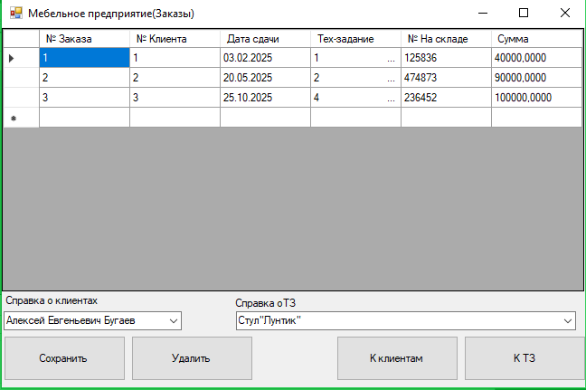
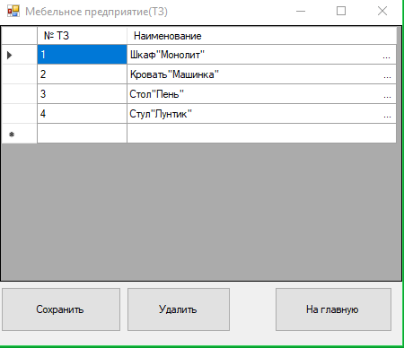

# Мебельное предприятие — учёт клиентов и технического задания

> Курсовой проект: десктопное приложение **C# / WinForms** с базой данных
> **MS SQL Server** и проектной документацией (UML в ArgoUML, ER-модель).
> Автор: Бугаев Евгений Валерьевич.

## Возможности
- Ведение списка **клиентов** (`Clients`).
- Работа с **техническим заданием / заказами** (`TZ`).
- Просмотр данных из БД предприятия (`mebel_predpr`).

## Технологии
| Слой | Технология |
|---|---|
| Язык | C# (.NET Framework) |
| UI | Windows Forms |
| Доступ к данным | ADO.NET, типизированный DataSet |
| БД | MS SQL Server |

## Структура
```
Mebel_predpr.sln
Form1.*, Clients.*, TZ.*          # формы
Mebel_predprDataSet.xsd           # типизированный DataSet
```

## Документация (`docs/`)
- Пояснительная записка (`Курсовая.doc`) и ТЗ (`тз.docx`).
- UML-диаграммы (вариантов использования, классов, деятельности) в формате ArgoUML (`.zargo`).
- ER/функциональная модель (`Мебельное предприятие.rsf`).
- Скриншоты интерфейса.

## Запуск
1. Развернуть БД (скрипт/`.mdf` формируются отдельно).
2. Открыть `Mebel_predpr.sln` в Visual Studio и запустить.

## Интерфейс



